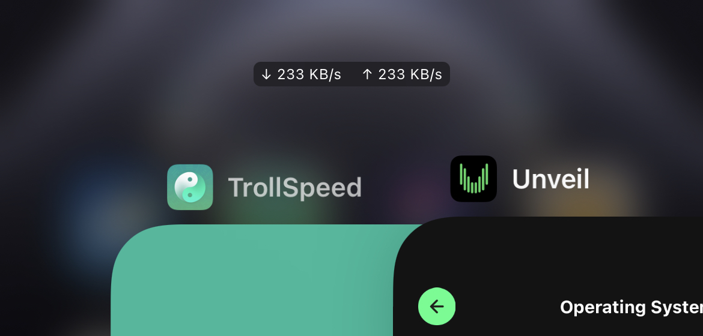

# TrollSpeed

Shows upload &amp; download speed below the status bar.

Tested and expected to work on all iOS versions supported by opa334’s TrollStore.

You need to enable “Developer Mode” on iOS 16 or above to use TrollSpeed or Misaka.

## 本仓库改动：流量统计 + 液体悬浮窗

在 TrollSpeed 1.11.11 源码上新增数据流量配额，并把它做成悬浮窗里的液体液位：

- 设置页最前面三项：「流量统计」开关、「可用流量」（输入 GB）、「已用流量」（可清零）
- 悬浮窗胶囊变成液体柱，液面高度 = 剩余比例，用量涨、液面降
- 双正弦波浪 + 气泡上浮，30fps 平滑缓动；液位越低浪越小
- 剩余 > 50% 极光蓝，20%–50% 琥珀，≤ 20% 红色呼吸
- 轻点悬浮窗多显示一行「剩余 x.xx GB」
- 用量按 `en*` / `pdp_ip*` 收发字节差累计，每 10 秒落盘，重启自动重设基准
- 配额状态单独存 `/var/mobile/Library/Preferences/ch.xxtou.hudapp.quota.plist`

安装包：[Releases](https://github.com/zhangwenwei44/llxf/releases) 里的 `TrollSpeed_DataQuota_1.11.11.tipa`，TrollStore 直接安装（覆盖同名 App，原设置保留）。

详细说明见 [`流量统计改造说明.md`](流量统计改造说明.md)，效果示意图见 `液体效果示意.png`。

> CI 注意：`macos-13` 已于 2025-12-04 退役（任务会空排队 24 小时再取消），`macos-14`/`macos-15` 为 arm64、部分免费账号会报 `configuration not supported`。本仓库使用 **`macos-15-intel`**（x86_64，支持到 2027-08）。

## How it works?

[TrollStore](https://github.com/opa334/TrollStore) + [UIDaemon](https://github.com/limneos/UIDaemon) + [NetworkSpeed13](https://github.com/lwlsw/NetworkSpeed13) + (some magic)
\=

- An TrollStore app to spawn HUD process with root privilege.
- Don’t call `waitpid` to that process. Let it go.
- A HUD app with entitlements from `assistivetouchd` to display and persist global windows.

## How to build?

- Use [theos](https://github.com/theos/theos) to compile.
  - `FINALPACKAGE=1 make package`
- You'll get a `.tipa` file in `./packages` folder.
- Don't like **theos**? Use `./build.sh` to build with Xcode.

## Caveats

- Spawn with root privileges is **required**. Otherwise, the HUD process will be killed by SpringBoard when unlocking device.
- TrollSpeed will observe its app removal and terminate its HUD.

## Notes

- Please give me feedback if you find any issues &amp; bugs, or have any suggestions.
- Give me a star 🌟 if you like this project. Thanks!

## Screenshots

## Special Thanks

- [KIF](https://github.com/kif-framework/KIF)
- [SPLarkController](https://github.com/ivanvorobei/SPLarkController) by [@ivanvorobei_](https://twitter.com/ivanvorobei_)
- [TrollStore](https://github.com/opa334/TrollStore) by [@opa334dev](https://twitter.com/opa334dev)
- [UIDaemon](https://github.com/limneos/UIDaemon) by [@limneos](https://twitter.com/limneos)
- [NetworkSpeed13](https://github.com/lwlsw/NetworkSpeed13) by [@johnzarodev](https://twitter.com/johnzarodev)
- [SnapshotSafeView](https://github.com/Stampoo/SnapshotSafeView) by [Ilya knyazkov](https://github.com/Stampoo)

## License

TrollSpeed is [Free Software](https://www.gnu.org/philosophy/free-sw.html) licensed under the [GNU General Public License](LICENSE).

### Localization

To add a language, create a new `.lproj` folder in `Resources`.

- en/zh-Hans [@Lessica](https://github.com/Lessica)
- es [@Deci8BelioS](https://github.com/Deci8BelioS)
